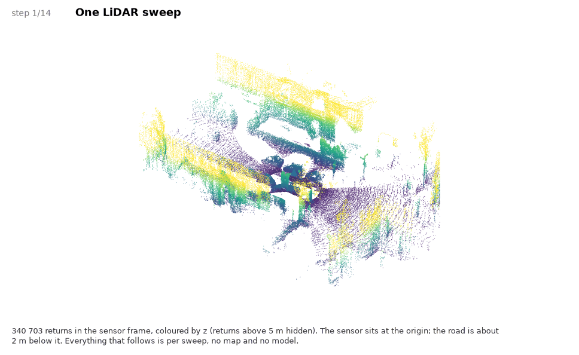
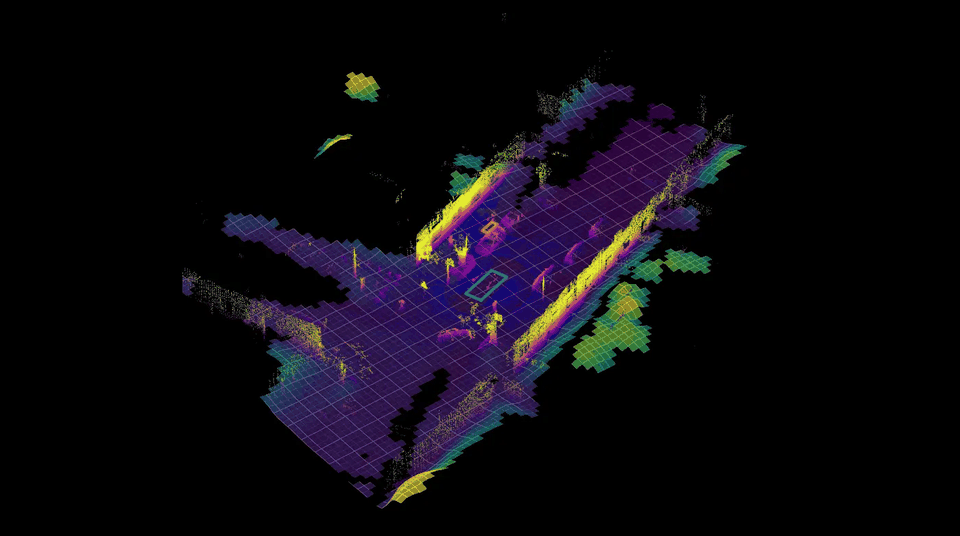

# PoissonPillars: Improving Heterogeneous Cooperative Perception with PoissonFloor and the V2B Dataset

Code for an anonymous submission: a viewer for V2B, a cooperative-perception
dataset recorded by a car and a sensor-equipped bicycle, with five sample
frames.

<p align="center"><br>
<em>How a PoissonFloor is built from one LiDAR sweep.</em></p>

<p align="center"><br>
<em>The floor as a mesh under the sweeps of the car (blue) and the bicycle
(orange), points coloured by height above the floor.</em></p>

## Run

```bash
uv run app.py
```

Requires [uv](https://docs.astral.sh/uv/). The viewer opens at
<http://127.0.0.1:5005>. Options: `--port`, `--no-browser`, `--root`.

## Sample

`samples/scene_04/` holds five annotated keyframes (0, 40, 60, 80, 100) of
scene 4 in the nuScenes format, with the bicycle within 10 m of the car:

- `lidar/<frame>.pcd.bin`: the fused sweep of both agents in the car's
  LiDAR frame, `float32` `x, y, z, intensity, agent` (1 car, 2 bicycle).
- `annotation/`: nuScenes tables with the 3D boxes of these five frames,
  the car's poses (`ego_pose.json`) and the bicycle's
  (`ego_pose_helper.json`).
- `floor.ply`: the scene's floor as a triangle mesh on a 0.5 m grid.

No camera images are included.

## Viewer

- **Agents:** show the points and boxes seen by the car, the bicycle or
  both.
- **Floor:** draw the floor mesh; colour points by height above it or hide
  the ground points.
- **Detections (optional):** a folder `samples/<scene>/methods/<id>/` with
  nuScenes tables plus `score` and `agent` per box is shown next to the
  annotation and scored against it (centre-distance AP).

## License

Code: MIT (see `LICENSE`). Data: CC BY-NC-SA 4.0.
